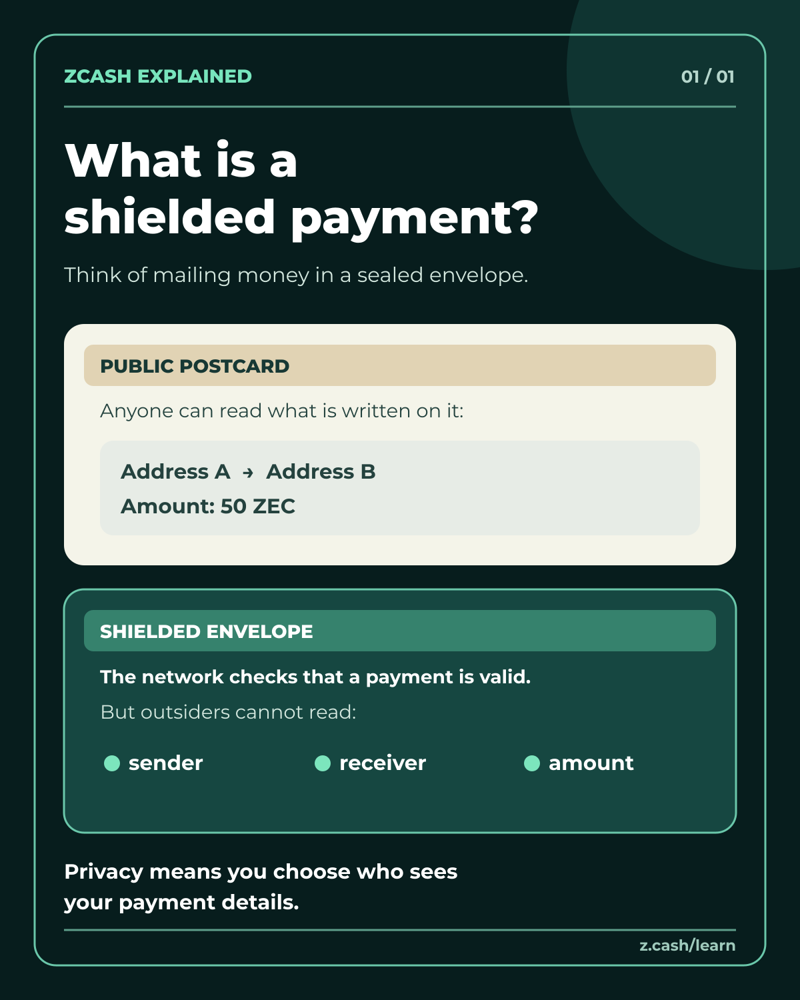

# What is a shielded payment?

An original beginner poster for the [Zcash India “Explain Zcash Like I'm New” bounty](https://zcashind.com/bounties/explain-zcash-september-2026).

- [Download PNG](shielded-payment-beginner.png) — 1200 × 1500 px.
- [Download editable SVG](shielded-payment-beginner.svg) — text and shapes are editable; Montserrat is embedded for consistent display.
- [Font license](Montserrat-OFL.txt).

The postcard and sealed-envelope comparison is an analogy, not a protocol diagram. It compares a fully transparent transfer with a fully shielded transfer. The Zcash network can validate shielded transfers without making the sender, recipient, or amount publicly readable. A transfer involving a transparent address can still reveal information about its transparent side; this poster does not claim otherwise. The numbers on the postcard are invented illustration, not live chain data.

Technical reference: [Zcash documentation — Addresses and Value Pools](https://zcash.readthedocs.io/en/latest/rtd_pages/addresses.html).

## Entry status

Prepared on November 10, 2026. The bounty page labels itself “Open now” but is also titled “Sept 2026” and does not give a clear closing date. Confirm eligibility before submitting. The instructions require an original public X post tagging @ZcashIND; a GitHub upload alone is not an entry. No X post has been made and no award or payout is claimed. AI tools assisted with the artwork; this is disclosed because the bounty permits AI content.

Suggested post after confirming the window is still open:

> What is a Zcash shielded payment? Think of a sealed envelope: the network checks the payment is valid, while outsiders cannot read the sender, receiver or amount. A transparent transfer is more like a public postcard. A beginner explainer I made with AI-assisted design for @ZcashIND. #Zcash

Attach shielded-payment-beginner.png as an actual image to the post; do not paste the filename as text.
